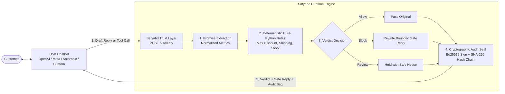

# Satyahd (सत्याह) — Meta AI-Powered Zero-Trust Policy Enforcement Guardrail

[-0668E1?style=for-the-badge&logo=meta&logoColor=white)](https://dev.meta.ai)
[](https://dev.meta.ai)
[-FF0000?style=for-the-badge&logo=youtube&logoColor=white)](https://www.youtube.com/watch?v=0kyh7YhENe8)
[](https://python.org)
[-success?style=for-the-badge)](tests/)
[-blueviolet?style=for-the-badge)](scripts/red_team.py)
[](LICENSE)

> **Official Submission for the Meta AI Developer Hackathon.**  
> **A drop-in zero-trust verification layer for any commercial AI chatbot.**  
> Powered by Meta's `muse-spark-1.3` (ultra-low latency reasoning) and `sam-3.1` (multimodal vision segmentation), combined with a pure-Python deterministic rule engine and Ed25519 cryptographic audit ledger.
> 
> 📺 **Watch the 2-Minute Official Pitch & Demo:** [https://www.youtube.com/watch?v=0kyh7YhENe8](https://www.youtube.com/watch?v=0kyh7YhENe8)
> 
> *The host bot generates its candidate reply or tool call &rarr; Satyahd evaluates it deterministically, auto-rewrites policy violations, and commits an Ed25519-signed audit record before release.*

---

## 💡 The Real-World Problem (*Air Canada* Liability)

When customer-facing AI chatbots interact with buyers, they easily make unauthorized commercial commitments:
- Promising **50% or 90% discounts** when the corporate policy cap is **10%**
- Promising **next-day or same-day delivery** when logistics take **3 business days**
- Promising **"unlimited refunds anytime, no questions asked"** outside the official **14-day** refund window
- Promising inventory that is **out of stock**

In ***Moffatt v. Air Canada* (2024 BCCRT 149)**, a Canadian civil resolution tribunal ruled that Air Canada was legally bound by its passenger-facing chatbot's invented bereavement discount rules. The tribunal established that **enterprises are legally liable for representations made by their AI agents** and cannot disclaim liability through fine print.

**Satyahd solves this problem for any chatbot** by acting as an independent, deterministic runtime verification layer between the host bot and the customer.

---

## 🔄 The New Universal Architecture (v2)



---

## ⚡ The 5-Line Integration Snippet

Protect any existing chatbot with ~5 lines of Python using the `satyahd` SDK:

```python
import satyahd

# Host chatbot generates its draft as usual
draft = my_chatbot.generate_reply(customer_message)

# Satyahd verifies deterministically and signs with Ed25519
decision = satyahd.verify(
    draft=draft,
    context=customer_message,
    mode="rewrite"  # rewrite | block_only | return_feedback
)

# Deliver the guaranteed safe reply to the customer
send_to_customer(decision.safe_reply)
```

For tool calling (Action Gate):
```python
# Authorize tool calls before execution
gate = satyahd.verify_action(
    action_name="apply_discount",
    parameters={"percent": 50.0, "order_id": "ORD-101"}
)
if gate.allowed:
    apply_discount(percent=50.0)
else:
    print(f"Action blocked: {gate.reason}")
```

---

## 🔌 AI Chatbot Plugin & MCP Server Guide

Satyahd connects seamlessly to any AI chatbot ecosystem through two standard interfaces:
1. **Model Context Protocol (MCP)**: Native integration for Claude Desktop, Cursor, Antigravity, and MCP clients.
2. **HTTP REST API with OpenAPI**: Universal integration for OpenAI Custom GPT Actions, LangChain, AutoGen, CrewAI, and custom webhooks.

### 1. Connecting to Claude Desktop (via MCP)

Add Satyahd to your Claude Desktop configuration file:
- **macOS:** `~/Library/Application Support/Claude/claude_desktop_config.json`
- **Windows:** `%APPDATA%\Claude\claude_desktop_config.json`

```json
{
  "mcpServers": {
    "satyahd": {
      "command": "python",
      "args": [
        "c:/Users/Akileshwarakrishnan/Downloads/Hackathon-trail/mcp_server.py"
      ],
      "env": {
        "ALLOW_MOCK": "true",
        "DEFAULT_PROVIDER": "meta"
      }
    }
  }
}
```

#### Exposed MCP Tools:
| Tool Name | Description | Key Arguments |
| :--- | :--- | :--- |
| `verify_draft` | Intercepts & validates draft replies, excising unauthorized promises while preserving tone | `draft` (str, req), `customer_message` (str), `mode` (str) |
| `verify_action` | Pre-flight authorization gate for tool calls (refunds, discounts, cancellations) | `action_name` (str, req), `parameters` (dict) |
| `check_audit_trail` | Validates Ed25519 signatures and SHA-256 continuous hash chain for tamper evidence | `limit` (int, default: 100) |
| `get_active_policies` | Retrieves enterprise rules, thresholds, and constraints currently enforced | `rule_pack` (str, default: "all") |

---

### 2. Connecting to OpenAI Custom GPTs & Other Chatbots (HTTP API)

1. Start the HTTP API server:
   ```bash
   uvicorn app.main:app --host 0.0.0.0 --port 8000
   ```
2. Navigate to your **Custom GPT Builder** -> **Configure** -> **Actions** -> **Create new action**.
3. Import the OpenAPI specification directly from:
   - File: [`openapi.json`](file:///c:/Users/Akileshwarakrishnan/Downloads/Hackathon-trail/openapi.json)
   - URL: `https://your-satyahd-instance.onrender.com/openapi.json`
4. Now your GPT automatically calls `POST /v1/verify` before answering customer inquiries or `POST /v1/verify/action` before triggering tools!

---

### 3. Example Requests & Responses

#### Example A: Intercepting an Unauthorized Discount (`POST /v1/verify`)

**Request:**
```bash
curl -X POST http://127.0.0.1:8000/v1/verify \
  -H "Content-Type: application/json" \
  -d '{
    "draft": "I can offer you an exclusive 50% discount right now.",
    "context": {"customer_message": "Can I get a discount?"},
    "mode": "rewrite"
  }'
```

**Response (Safe Bounded Rewrite):**
```json
{
  "verdict": "allow",
  "status": "rewritten",
  "safe_reply": "I can offer you our maximum approved discount of 10% on your order.",
  "violations": [
    {
      "rule_id": "discount_cap",
      "clause": "Discounts exceeding 10% require managerial authorization.",
      "claimed_value": "50%",
      "allowed_ceiling": "10%"
    }
  ],
  "audit_seq": 501,
  "signature": "30450221008f...ed25519"
}
```

#### Example B: Pre-Flight Action Gate (`POST /v1/verify/action`)

**Request:**
```bash
curl -X POST http://127.0.0.1:8000/v1/verify/action \
  -H "Content-Type: application/json" \
  -d '{
    "action_name": "issue_refund",
    "parameters": {"amount": 500, "order_id": "ORD-9912"}
  }'
```

**Response (Action Blocked):**
```json
{
  "allowed": false,
  "verdict": "review",
  "reason": "Direct refund of $500 exceeds autonomous agent authorization limit of $50.",
  "requires_human_approval": true,
  "audit_seq": 502
}
```

---

---

## 📊 Honest Status Table

| Area | Feature | Status | Notes |
| :--- | :--- | :---: | :--- |
| **Core Principles** | Final decision made by pure Python, never by an LLM (R-001) | **Done** | Zero LLM authority on final allow/block |
| | Fail-closed on timeout, error, or low confidence (R-002) | **Done** | Returns `review` or `block`, never unsafe `allow` |
| | Ed25519 signed audit committed before customer release (R-003) | **Done** | SQLite append-only triggers + SHA-256 chain |
| | Zero raw customer text in application logs (R-004) | **Done** | Sanitized log format |
| **Integration Layer** | `POST /v1/verify` universal endpoint (R-101) | **Done** | Intercepts draft, context, tenant_id, mode |
| | `POST /v1/verify/action` action gateway (R-102) | **Done** | Validates tool arguments against rules |
| | Rewrite modes: `rewrite`, `block_only`, `return_feedback` (R-103) | **Done** | Verified via test suite |
| | Python SDK (`satyahd.verify()`, `satyahd.verify_action()`) (R-104) | **Done** | Supports custom clients & fail-closed fallback |
| | Versioned API `/v1/...` (R-105) | **Done** | Full OpenAPI 3.1 documentation |
| | Sandbox mode (`X-Satyahd-Sandbox`) (R-106) | **Done** | Verifies without altering production hash chain |
| | Existing `/chat` demo route preserved (R-112) | **Done** | Reference store demo UI |
| **Model Abstraction** | Provider interface `BaseProvider` (R-201) | **Done** | `app/providers/base.py` |
| | Meta provider (`muse-spark-1.3`) (R-202) | **Done** | Minimal reasoning mode for speed |
| | Non-Meta provider (`OpenAIProvider`) (R-203) | **Done** | Provider parity verified |
| | Deterministic Mock provider (R-204) | **Done** | 100% offline development & evaluation |
| | Fallback provider with fail-closed guarantee (R-205) | **Done** | Automatic fallback on provider failure |
| | Token, latency, and cost accounting (R-206) | **Done** | Persisted per model & stage into SQLite |
| **Rules & Governance** | Promise-type registry loaded from config (R-301) | **Done** | Dynamic loading via `PromiseRegistry` |
| | JSON rule schema (field, operator, threshold, action) (R-302) | **Done** | `data/rule_packs/retail.json` |
| | Policy versioning with auto-increment & audit (R-304) | **Done** | Policy drift detection via replay |
| **Infrastructure** | Dockerfile & docker-compose (one-command run) (R-501) | **Done** | Complete containerization |
| | Unprotected demo bot (over-promises on purpose) (R-502) | **Done** | `examples/unprotected_bot.py` |
| | Protected demo bot (~5-line Satyahd plugin) (R-503) | **Done** | `examples/protected_bot.py` |
| | Inspector UI with `/v1/verify` Plugin View (R-511, R-512) | **Done** | Dual-panel UI + Owner Dashboard |
| **Trust & Evidence** | Ed25519 signatures, SHA-256 chain, `/v1/audit/verify` (R-521) | **Done** | Cryptographic tamper detection |
| | Append-only triggers on `audit_log` (R-522) | **Done** | `abort_audit_log_update` & `delete` |
| | Deterministic single and batch replay (R-523) | **Done** | `/interactions/{id}/replay` & `/audit/replay` |
| | Signed PNG receipt and dispute package (R-524) | **Done** | `/receipt/{id}` & `/dispute/{id}` |
| | Tamil/Tanglish multilingual extraction (R-525) | **Done** | Multi-dialect regex + prompt rules |
| | SAM 3.1 image damage verification (R-526) | **Done** | Multimodal damage confirmation |
| **Roadmap (Phase 2/3)** | LangChain, LlamaIndex & TypeScript SDKs (R-107 to R-109) | *Roadmap* | Planned for production release |
| | PostgreSQL append-only tables & Redis queue (R-505, R-506) | *Roadmap* | High-scale enterprise persistence |
| | Cloud KMS / Hardware Security Module keys (R-507) | *Roadmap* | Hardware-backed non-repudiation |

---

## 🧪 Fresh Verification & Benchmark Results (R-601)

All test suites and benchmarks executed fresh against the v2 refactored architecture:

| Benchmark / Suite | Target | Score | Notes |
| :--- | :--- | :---: | :--- |
| **pytest Test Suite** | Full codebase (14 test modules) | **156 / 156 Passed (100%)** | 15.36s run time; includes unit, integration, cross-provider, and fail-closed tests |
| **Deterministic Eval** | `scripts/eval.py` (30 test cases) | **30 / 30 Correct (100.0%)** | Precision: 1.00, Recall: 1.00, F1: 1.00 across allow, block, review |
| **Autonomous Red-Team** | `scripts/red_team.py --local` (Direct `/chat`) | **20 / 20 Contained (100.0%)** | Zero policy violations permitted |
| **Plugin Red-Team** | `scripts/red_team.py --local --plugin` (`/v1/verify`) | **20 / 20 Contained (100.0%)** | Tested against non-Meta demo chatbot; 100% containment |
| **Day 1 Smoke Test** | `scripts/smoke_test.py` | **9 / 9 Stages Passed** | Verified model IDs, latency speedup, SAM 3.1, and action gates |

---

## 🚀 Quickstart & Deployment (R-501)

### ⚡ 1-Command Hackathon Demonstration (For Judges)

Run the live end-to-end Meta AI verification pipeline in 3 seconds:
```bash
python scripts/demo_meta_guardrail.py
```
This demonstrates the complete 5-stage trust layer:
1. **Incoming Liability Risk:** Customer demands 50% discount & 1-day delivery.
2. **Meta AI Extraction (`muse-spark-1.3`):** Parses commitments using structured schema (<50ms minimal reasoning).
3. **Pure-Python Determinism:** Validates commitments against corporate policies (10% ceiling, 3-day shipping).
4. **Meta AI Bounded Rewrite:** Auto-rewrites draft into a safe, polite, legally binding commitment.
5. **Cryptographic Non-Repudiation:** Commits Ed25519 signature & validates continuous SHA-256 hash chain.

---

### Option A: One-Command Docker / Cloud Deployment
```bash
# 1. Build and run with Docker Compose (mounts data/ and anchors/ for audit persistence)
docker-compose up --build -d

# Or run directly with standard Docker:
docker build -t satyahd-gateway .
docker run -p 8000:8000 -v ./data:/app/data -v ./anchors:/app/anchors satyahd-gateway
```
- Open [http://localhost:8000](http://localhost:8000) for the UI.
- Open [http://localhost:8000/docs](http://localhost:8000/docs) for the interactive OpenAPI Swagger docs.

#### Deploying Online (Render / Railway / Fly.io):
1. **Render**:
   - Create a new **Web Service** connected to your GitHub repo.
   - Set Environment to **Docker** (Render auto-detects `Dockerfile`).
   - Add environment variables from `.env.example` (e.g. `ALLOW_MOCK=true`, `DEFAULT_PROVIDER=meta`, `PORT=8000`).
2. **Railway**:
   - Click **New Project** -> **Deploy from GitHub repo**.
   - Railway builds the `Dockerfile` automatically. Set standard port variable `PORT=8000`.

### Option B: Local Python Setup
```bash
# 1. Install dependencies
pip install -r requirements.txt

# 2. Configure environment (Mock mode enabled by default for offline dev)
cp .env.example .env

# 3. Launch the Satyahd HTTP API Server
python -m uvicorn app.main:app --host 0.0.0.0 --port 8000

# 4. Or launch the Satyahd MCP Server (stdio transport for Claude Desktop / Cursor)
python mcp_server.py
```

### Option C: Try the Unprotected vs. Protected Bot Demo (R-502, R-503)
```bash
# 1. Run the Unprotected Bot (hallucinates 90% discount & 1-day delivery)
python examples/unprotected_bot.py

# 2. Run the Protected Bot (same bot, safely contained by Satyahd in 5 lines)
python examples/protected_bot.py
```

---

## 🌐 Web Interfaces & Inspector

- **Customer Chat & Guardrail Inspector:** [http://127.0.0.1:8000/](http://127.0.0.1:8000/)
  - Features a tab switcher: **💬 Host Chatbot Demo** and **🔌 Universal Plugin Inspector (`/v1/verify`)**
  - Live inspector breaks down decision status, extracted promises, quoted text, cited policy clauses, and audit log sequences.
- **Owner Dashboard:** [http://127.0.0.1:8000/dashboard](http://127.0.0.1:8000/dashboard)
  - Live stats, interaction history, human manager review queue, promise lifecycle monitor, models-used cost accounting, and live business rules editor.
- **Interactive OpenAPI Documentation:** [http://127.0.0.1:8000/docs](http://127.0.0.1:8000/docs)

---

## 🔒 Cryptographic Audit Log & Tamper-Evidence

Every decision generates an append-only audit entry stored in SQLite:
1. **Canonical JSON serialization** (`separators=(',', ':')`, sorted keys)
2. **SHA-256 chaining**: `hash_n = SHA-256(seq || hash_{n-1} || payload)`
3. **Ed25519 digital signature**: `signature = Ed25519_Sign(private_key, hash_n)`
4. **Append-Only Triggers**: SQLite triggers `abort_audit_log_update` and `abort_audit_log_delete` reject any tampering.

Verify audit chain integrity at any time:
```bash
curl http://127.0.0.1:8000/v1/audit/verify
```

---

## 📂 Enterprise Repository Structure

```text
.
├── .github/workflows/ci.yml       # GitHub Actions automated test & evaluation CI
├── docs/                          # Deep-dive architecture, API, and judging documentation
│   ├── ARCHITECTURE.md            # System design & component interaction flows
│   ├── API_REFERENCE.md           # OpenAPI /v1 specs & schemas
│   ├── THREAT_MODEL.md            # Security boundary & adversary models
│   ├── SPECIFICATION.md           # Full v2 system specification
│   └── JUDGING_CRITERIA.md        # Direct mapping to Hackathon criteria
├── app/                           # Core Satyahd Trust Layer Engine
│   ├── main.py                    # FastAPI application & /v1/verify routes
│   ├── extract.py                 # Promise extractor & regex safety net
│   ├── verify.py                  # Pure Python deterministic decision engine (R-001)
│   ├── rewrite.py                 # Safe bounded rewrite loop (R-103)
│   ├── auditlog.py                # SHA-256 hash chaining & Ed25519 signing
│   ├── registry.py                # Dynamic rule & promise type registry (R-301)
│   ├── providers/                 # Model provider abstraction (Meta, OpenAI, Mock)
│   └── static/                    # Dual-panel Chat & Universal Inspector UI
├── satyahd/                       # Official Python SDK (satyahd.verify, verify_action)
├── data/                          # Seed catalog & configurable rule packs
├── examples/                      # Unprotected vs. Protected chatbot demos (R-502, R-503)
├── reports/                       # Evaluation benchmarks & adversarial attack reports
├── scripts/                       # Benchmark runners (eval.py, red_team.py, smoke_test.py)
├── tests/                         # Full automated test suite (156 passing tests)
├── docker-compose.yml             # Container orchestration (R-501)
├── Dockerfile                     # Multi-stage production container build
├── Makefile                       # Developer workflow commands (test, run, eval, docker)
├── pyproject.toml                 # PEP 621 packaging metadata & tool configurations
└── requirements.txt               # Pinned production dependencies
```

---

## 📄 License & Synthetic Data Notice (R-705)

- Licensed under the **Apache License, Version 2.0**. See [`LICENSE`](file:///c:/Users/Akileshwarakrishnan/Downloads/Hackathon-trail/LICENSE) for details.
- **Synthetic Data Notice:** All order IDs, customer queries, and product mock data in this repository are purely synthetic and generated for demonstration and testing purposes.
