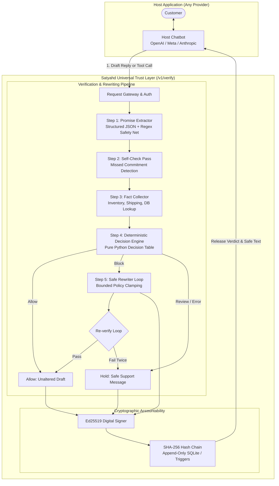

# Satyahd Architecture & System Design

## 1. System Philosophy: Deterministic Trust Layer

Satyahd is an out-of-band, drop-in verification gateway for enterprise AI chatbots. It provides a deterministic barrier between non-deterministic conversational models and the real-world commitments they make to customers.

---

## 2. Core Subsystems

### 2.1. Ingestion & Interception Layer (`app/main.py`)
- **`POST /v1/verify`**: Intercepts natural language drafts proposed by external chatbots. Accepts `{draft, context, tenant_id, mode}`.
- **`POST /v1/verify/action`**: Intercepts action-tool invocations before backend execution. Accepts `{action_name, parameters, context, tenant_id}`.
- **Rewrite Modes (R-103)**:
  - `rewrite`: Automatically clamps unauthorized claims to authorized policy caps.
  - `block_only`: Replaces violating draft with a neutral customer holding reply.
  - `return_feedback`: Holds draft and returns structured violation details for upstream re-prompting.
- **Sandbox Execution (R-106)**: Requests with header `X-Satyahd-Sandbox: true` execute full promise extraction and rule evaluation without writing to the production cryptographic audit sequence.

### 2.2. Promise Extraction Engine (`app/extract.py`)
- Employs strict JSON schemas (`ExtractionEnvelope`, `Promise`) to extract metric commitments (discount percentages, delivery transit days, refund windows, stock inventory counts).
- **Exact Substring Verification**: Verifies that quotes exist verbatim in the draft; downgrades confidence if quotes are hallucinated.
- **Regex Safety Net**: Scans for uncovered numeric tokens and guarantee keywords (`free`, `guarantee`, `refund`, `tomorrow`) to ensure zero unextracted commitments escape.

### 2.3. Deterministic Decision Engine (`app/verify.py`)
- **Strictly Pure Python Code**: No LLM ever participates in the final Allow/Block/Review decision.
- Compares extracted promises against active policy rules loaded from configuration packs (`data/rule_packs/retail.json`).
- Aggregates verdicts: any `BLOCK` results in a message-level `BLOCK`; any unresolvable ambiguity or confidence $< 0.60$ forces `REVIEW` (fail-closed).

### 2.4. Cryptographic Audit Chain (`app/auditlog.py`)
- **Sequential SHA-256 Hash Chaining**: `h_n = SHA256(seq || h_{n-1} || payload)`.
- **Ed25519 Asymmetric Signatures**: Each hash is signed using an Ed25519 private key.
- **Database Append-Only Triggers**: SQLite triggers `abort_audit_log_update` and `abort_audit_log_delete` reject any `UPDATE` or `DELETE` operations on `audit_log`.
- **Hard Rule 3**: The audit record must be committed to disk *before* the verified message is returned to the caller.

### 2.5. Model Provider Abstraction (`app/providers/`)
- Abstract base provider (`BaseProvider`) with token, latency, and cost accounting.
- Native implementations for Meta API (`muse-spark-1.3`), OpenAI (`gpt-4o-mini`), and deterministic mock (`MockProvider`).
- Automatic fallback: if the primary provider times out or fails, gracefully falls back to secondary provider while maintaining fail-closed integrity.
